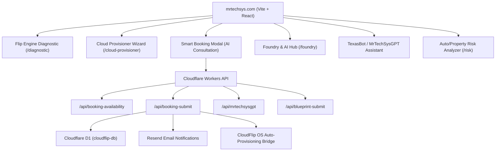

# MrTechSys · Digital Transformation Ecosystem
### *Texas-Rooted Simplicity · Free First, Scale Smart*

[](https://mrtechsys.com)
[](https://reactjs.org/)
[](https://vitejs.dev/)
[](https://developers.cloudflare.com/d1/)
[](https://developers.cloudflare.com/workers-ai/)

The official website, technical interactive tools, and client advisory engine for **MrTechSys** ([mrtechsys.com](https://mrtechsys.com)).

MrTechSys connects modern enterprise software, automates business bottlenecks, and equips organizations with lean, zero-cost cloud foundations before scaling.

---

## 🌟 Core Modules & Architecture



### 1. Smart Booking Engine (Native Calendly Replacement)
- **Zero-Friction Scheduling**: Dynamic availability engine respecting working hours (Mon–Fri 9 AM–7 PM, Sat 9 AM–5 PM CST), 15-minute buffers, 24-hour advance notice, and daily caps.
- **5-Step Cinematic Modal**:
  1. *Service Selection* (AI Automation, Cloud Migration, DevOps, CloudFlip Setup, etc.)
  2. *Qualifying Questions* (Industry, Bottleneck, Budget, Timeline)
  3. *Instant AI Architecture Plan* (synthesized live by MrTechSysGPT)
  4. *Slot & Meeting Format Picker* (30/45/60 min slots, Zoom/Meet/Phone)
  5. *Contact Details & Instant Confirmation*
- **Ecosystem Bridge to CloudFlip OS**:
  - *Non-pressured default*: Sends users a clean invite email with a direct login link to `cloudflip.mrtechsys.com`.
  - *Buy-in detected path*: If notes or AI indicate intent, automatically calls CloudFlip's provisioning bridge to create their workspace and dispatch an OTP code.

### 2. The Flip Engine® Diagnostic
- Quantifies operational drag across missed phone calls, delayed invoicing, and duplicate data entry.
- Generates a bespoke operational recovery blueprint.

### 3. Cloud Provisioner Wizard
- Interactive multi-step architectural builder mapping client workloads (Frontend, API, DB, Storage, Auth) to permanent free-tier developer allocations across Cloudflare, AWS, and Azure.
- Sends 10-point activation playbooks via Resend.

### 4. TexasBot / MrTechSysGPT
- Virtual Senior Cloud Architect running on Cloudflare Workers AI (Llama 3) with intelligent conversational routing and contextual guidance.

---

## 🛠️ Tech Stack

| Layer | Technology |
|---|---|
| **Frontend** | React 18, Vite, TailwindCSS, Framer Motion, Lucide Icons |
| **Edge Compute** | Cloudflare Pages Functions (TypeScript / ESM) |
| **Database** | Cloudflare D1 Serverless SQL (`cloudflip-db`) |
| **Email Delivery** | Resend API (`notifications@mrtechsys.com`) |
| **AI Runtime** | Cloudflare Workers AI (`@cf/meta/llama-3-8b-instruct`) with multi-cloud fallback |
| **Security** | Zero-Trust headers, JWT middleware guard, honeypots, rate limiters |

---

## 🚀 Local Development

### Prerequisites
- Node.js 18+
- npm 9+
- Cloudflare Wrangler CLI (`npm install -g wrangler` or `npx wrangler`)

### Getting Started

1. **Clone the repository**:
   ```bash
   git clone https://github.com/MrTechSys/mrtechsys-site.git
   cd mrtechsys-site
   ```

2. **Install dependencies**:
   ```bash
   npm install
   ```

3. **Run local Vite dev server**:
   ```bash
   npm run dev
   ```
   Open `http://localhost:5173` in your browser.

4. **Run Pages Functions locally with Wrangler**:
   ```bash
   npx wrangler pages dev dist --d1=DB=03af9f85-87c2-4473-a073-872c0dcb84c5
   ```

---

## 📦 Build & Deployment

### Production Build
```bash
npm run build
```
Generates production-ready static assets in `dist/`.

### Direct Deployment via Wrangler
```bash
npx wrangler pages deploy dist --project-name mrtechsys-site
```

---

## 🔐 Required Environment Variables & Bindings

Configured in Cloudflare Pages Dashboard under **Settings → Environment variables / Bindings**:

| Name | Type | Purpose |
|---|---|---|
| `DB` | D1 Database Binding | Points to `cloudflip-db` (`03af9f85-87c2-4473-a073-872c0dcb84c5`) |
| `AI` | Workers AI Binding | Binding for Cloudflare Workers AI execution |
| `RESEND_API_KEY` | Encrypted Secret | Resend API token for automated emails |
| `RESEND_FROM_EMAIL` | Plaintext Variable | `notifications@mrtechsys.com` |
| `OWNER_ALERT_EMAIL` | Plaintext / Secret | Target address for new booking & consultation notifications |
| `CLOUDFLIP_PROVISION_SECRET` | Encrypted Secret | Shared secret token for server-to-server CloudFlip workspace initialization |
| `ZOOM_MEETING_URL` | Plaintext Variable | (Optional) Static video consultation room URL |

---

## 📄 License
Proprietary © MrTechSys. All Rights Reserved.
